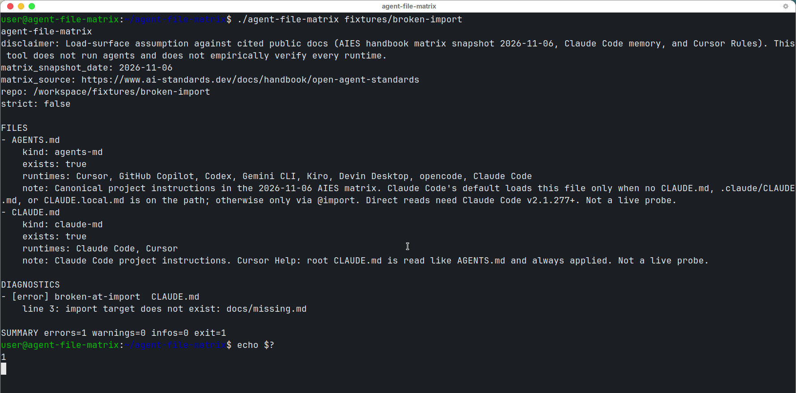

<p>
  <strong>Language / 语言 / 語言 / 言語:</strong>
  <a href="#lang-en">English</a>
  ·
  <a href="#lang-zh-Hans">简体中文</a>
  ·
  <a href="#lang-zh-Hant">繁體中文</a>
  ·
  <a href="#lang-ja">日本語</a>
</p>

<a id="lang-en"></a>

# agent-file-matrix

Offline inventory of known agent instruction files. Given a repository root, it lists which of the v0 paths exist, which runtimes **would load them according to cited public docs**, and emits mechanical trap diagnostics.

This is a **load-surface assumption** against those docs. It does not run Cursor, Claude Code, Copilot, Codex, Gemini CLI, Kiro, Devin, or opencode, and it does **not** claim those runtimes were empirically verified.

Matrix snapshot date: **2026-11-06** (AIES handbook, *Open Agent Standards and the Cross-Tool File Matrix*, Version 1.0).

## Quick start

Python 3.9+ standard library only. There is no dependency install.

```bash
git clone https://github.com/xuqijx/agent-file-matrix.git
cd agent-file-matrix
./agent-file-matrix ./fixtures/ok-shared
```

`python -m agent_file_matrix ./fixtures/ok-shared` is the same program.

Optional, if you want the command on `PATH` (uses setuptools already on the machine; this repo does not vendor or relicense it):

```bash
python -m pip install -e .
```

## Check script

```bash
python check.py
```

`check.py` blocks `socket` connects inside the check process, runs the fixture matrix and `tests/`, and prints a sha256 of `fixtures/` file bytes before and after (`find fixtures -type f -print0 | sort -z | xargs -0 sha256sum | sha256sum`). A hash change or a failed case exits non-zero. The scanner never writes to the tree it reads.

## CLI

```text
agent-file-matrix <repo-root> [--json] [--strict]
```

| Exit | Meaning |
|---|---|
| 0 | No error diagnostic. Warnings and infos are allowed. |
| 1 | At least one error diagnostic. |
| 2 | Usage or I/O (missing args, unknown flag, root missing, not a directory, or root not readable). |

`--help` exits 0. `--strict` upgrades **only** `shadow-no-import` from warning to error. Every other warning and info stays at its original severity.

`--json` prints one document (schema version 1). Key fields:

| Field | Meaning |
|---|---|
| `matrix_snapshot_date` | Always `2026-11-06` |
| `matrix_source` | AIES handbook URL |
| `disclaimer` | Load-surface assumption, not a live probe |
| `files[]` | `path`, `kind`, `exists`, `runtimes`, `note`, `citations` |
| `files_read` | Instruction files actually opened for `@` parsing |
| `diagnostics[]` | `id`, `severity`, `base_severity`, `strict_upgraded`, `path`, `line`, `import_target`, `related_paths`, `message` |
| `summary` | `errors`, `warnings`, `infos` |
| `exit_code` | Same value the process returns |

Paths are repo-relative and case-sensitive. Lists are sorted. Two `--json` runs on an unchanged tree produce the same document. File bodies are not printed. `.mdc`, `.cursorrules`, Copilot, Gemini, Devin, and Kiro files are inventoried without being read.

## Path table (v0)

Matched anywhere under the root except `.git`, a directory entry named `skills`, and a file named `SKILL.md`. Direct-child globs are **not** recursive.

| Path | Assumed readers (cited docs, not a live probe) |
|---|---|
| `AGENTS.md` (root and nested) | Cursor, GitHub Copilot, Codex, Gemini CLI, Kiro, Devin Desktop, opencode, Claude Code. Claude Code's **default** loads `AGENTS.md` only when no `CLAUDE.md`, `.claude/CLAUDE.md`, or `CLAUDE.local.md` is on the path; otherwise only through an `@` import. Direct reads need Claude Code v2.1.277+. Nested files are directory-scoped. |
| `CLAUDE.md` at the repo root | Claude Code. Cursor Help: root `CLAUDE.md` is read like `AGENTS.md` and always applied. |
| `.claude/CLAUDE.md`, other `CLAUDE.md`, `CLAUDE.local.md` | Claude Code. Each existing file is checked on its own. |
| `.cursor/rules/**/*.mdc` | Cursor project rules. v0 does **not** validate frontmatter. |
| `.cursor/rules/**/*.md` (not `.mdc`) | No runtime claimed. Cursor's rules system ignores plain `.md` here. |
| `.cursorrules` | Cursor (legacy; Help says it will be deprecated). AIES: legacy files may still be read and silently override. |
| `.windsurfrules` | Windsurf / Devin Desktop legacy, same AIES pitfall. The 2026-11-06 matrix's Devin instruction cell is `AGENTS.md` + `.devin/rules/*.md`. |
| `.github/copilot-instructions.md` | GitHub Copilot, alongside `AGENTS.md`. |
| `GEMINI.md` | **No runtime claimed.** The 2026-11-06 matrix lists Gemini CLI instructions as `AGENTS.md` via `context.fileName`, not `GEMINI.md`. The file is still inventoried because it is on the v0 path list. |
| `.devin/rules/*.md` | Devin Desktop. One directory level only. |
| `.kiro/steering/*.md` | Kiro. One directory level only. |

Citations carried in the JSON `citations` object:

- AIES handbook, updated 2026-11-06: https://www.ai-standards.dev/docs/handbook/open-agent-standards
- Claude Code memory: https://code.claude.com/docs/en/memory
- Cursor Rules: https://cursor.com/docs/rules
- Cursor Help (legacy `.cursorrules`, root `CLAUDE.md`): https://cursor.com/help/customization/rules
- AGENTS.md: https://agents.md/

## Six checks

| ID | Severity | When |
|---|---|---|
| `shadow-no-import` | warning (`--strict`: error) | Root `AGENTS.md` exists and this CLAUDE-side file has no `@` import that resolves to **that root file**. |
| `broken-at-import` | error | An `@path` in `CLAUDE.md`, `.claude/CLAUDE.md`, `CLAUDE.local.md`, or `AGENTS.md` resolves inside the repo and the target is missing. The diagnostic names the repo-relative path. |
| `legacy-instruction-file` | warning | Each `.cursorrules` or `.windsurfrules`. Two files produce two warnings. |
| `ignored-cursor-md` | warning | Any `*.md` under `.cursor/rules/` whose extension is not `.mdc`. Frontmatter does not matter. |
| `nested-agents` | info | An `AGENTS.md` that is not the repository root file. Does not by itself make the exit code non-zero. |
| `missing-canonical` | warning | At least one tool-specific path from the table above exists (everything except `AGENTS.md`, including ignored `.md` and legacy files) and root `AGENTS.md` is absent. One warning; `related_paths` lists the files. |

### Rules locked for v0

- **Shadow pairing.** Every CLAUDE-side file is compared with repository-root `AGENTS.md` only, not with the nearest nested `AGENTS.md`.
- **Valid import.** Not limited to the first line. Resolved relative to the instruction file's directory. `@AGENTS.md` and `@./AGENTS.md` are the same path; `@././AGENTS.md` normalizes the same way. From `.claude/CLAUDE.md`, root `AGENTS.md` is `@../AGENTS.md`. A literal `@AGENTS.md` there means `.claude/AGENTS.md` (missing → `broken-at-import`, and it does not clear shadow).
- **Spans and fences.** Tokens inside Markdown code spans or fenced blocks (`` ``` `` or `~~~`, indent 0–3) are ignored. A quoted path (`@"AGENTS.md"`) is not an import. An unclosed fence or span masks the rest of that region. Four-space indented lines are **not** treated as fences. HTML comments are not special-cased.
- **Outside targets.** Absolute paths, `~/...`, and relative paths that leave the repo root are info `out-of-root-skip`. They are not read and are not `broken-at-import`.
- **Symlinks.** Links that resolve outside the repo root are not followed and their target bytes are not read (`out-of-root-skip`). Cycles stop via inode identity and a 32-hop cap (`symlink-cycle`). The tool never writes.
- **Skills.** A directory entry named `skills` or a file named `SKILL.md` is skipped unread (`skipped-skill`). An `@` import that lands on such a path is the same info, not an error. v0 does not lint skill bodies.
- **Other info ids** (never upgraded by `--strict`): `unreadable-path`, `read-truncated` (instruction reads stop at 8 MiB), `traversal-limit`.

## Non-goals

No `SKILL.md` content lint, no AGENTS.md prose or heading schema, no MCP schema check, no file generation or rewrite, no staleness or contradiction lint, no claim of a security audit, no Product Hunt, no API keys, no company data.

## Demo

Real local run against `fixtures/broken-import` (exit 1). Not a star count or a user count.



## License

MIT. See [LICENSE](LICENSE). The scanner is Python standard library code written for this repository. Third-party projects are cited, not copied.

<a id="lang-zh-Hans"></a>

# agent-file-matrix（简体中文）

离线清单：给定仓库根目录，列出 v0 已知的 agent 指令文件是否存在、**按已引用公开文档**哪些运行时会读取它们，并给出可机械判断的加载陷阱。

输出是对照这些文档的**加载面假设**。本工具不启动 Cursor、Claude Code、Copilot、Codex、Gemini CLI、Kiro、Devin 或 opencode，也**不**宣称这些运行时已经过实测。

矩阵快照日期：**2026-11-06**（AIES handbook《Open Agent Standards and the Cross-Tool File Matrix》Version 1.0）。

## 三步运行

只需 Python 3.9+ 标准库，没有依赖安装步骤。

```bash
git clone https://github.com/xuqijx/agent-file-matrix.git
cd agent-file-matrix
./agent-file-matrix ./fixtures/ok-shared
```

等价命令：`python -m agent_file_matrix ./fixtures/ok-shared`。

若希望命令出现在 `PATH` 上，可选（使用本机已有的 setuptools；本仓库不内置、也不把它重新许可为 MIT）：

```bash
python -m pip install -e .
```

## 检查脚本

```bash
python check.py
```

`check.py` 在检查进程内拦截 `socket` 连接，跑夹具矩阵和 `tests/`，并按 `find fixtures -type f -print0 | sort -z | xargs -0 sha256sum | sha256sum` 打印扫描前后的夹具哈希。哈希变化或用例失败则非零退出。扫描器不会改写被扫描的目录树。

## 命令与退出码

```text
agent-file-matrix <repo-root> [--json] [--strict]
```

| 退出码 | 含义 |
|---|---|
| 0 | 没有 error。可以有 warning 和 info。 |
| 1 | 至少一条 error。 |
| 2 | 用法或 I/O（缺参数、未知旗标、根目录不存在、不是目录、或根目录不可读）。 |

`--help` 退出 0。`--strict` **只**把 `shadow-no-import` 从 warning 升为 error，其它 warning / info 不变。

`--json` 输出一份 schema version 1 的文档。字段：`matrix_snapshot_date`（恒为 `2026-11-06`）、`matrix_source`、`disclaimer`、`files[]`（`path` / `kind` / `exists` / `runtimes` / `note` / `citations`）、`files_read`（真正为解析 `@` 而打开的指令文件）、`diagnostics[]`（`id` / `severity` / `base_severity` / `strict_upgraded` / `path` / `line` / `import_target` / `related_paths` / `message`）、`summary`、`exit_code`。路径相对仓库根、区分大小写，列表排序稳定。不打印文件正文。`.mdc`、`.cursorrules`、Copilot、Gemini、Devin、Kiro 文件只登记、不读取内容。

## 路径表（v0）

除 `.git`、名为 `skills` 的目录项、名为 `SKILL.md` 的文件外，在整棵树里匹配。带「仅一层」的 glob 不递归。

| 路径 | 按引用文档的读取假设（不是实测） |
|---|---|
| 根与嵌套 `AGENTS.md` | Cursor、GitHub Copilot、Codex、Gemini CLI、Kiro、Devin Desktop、opencode、Claude Code。Claude Code **默认**仅在路径上没有 `CLAUDE.md`、`.claude/CLAUDE.md`、`CLAUDE.local.md` 时直接读 `AGENTS.md`，否则只通过 `@` 导入。直接读取需要 Claude Code v2.1.277+。嵌套文件的作用域是该目录。 |
| 仓库根 `CLAUDE.md` | Claude Code。Cursor Help：根目录 `CLAUDE.md` 与 `AGENTS.md` 同样读取，且总会应用到对话。 |
| `.claude/CLAUDE.md`、其它 `CLAUDE.md`、`CLAUDE.local.md` | Claude Code。每个已存在的文件单独检查。 |
| `.cursor/rules/**/*.mdc` | Cursor 项目规则。v0 **不**校验 frontmatter。 |
| `.cursor/rules/**/*.md`（非 `.mdc`） | 不声称有运行时。Cursor 规则系统会忽略这里的普通 `.md`。 |
| `.cursorrules` | Cursor（遗留；Help 写明将会弃用）。AIES：遗留文件仍可能被读取并静默覆盖。 |
| `.windsurfrules` | Windsurf / Devin Desktop 遗留文件，同一条 AIES 说明。2026-11-06 矩阵里 Devin 的指令格是 `AGENTS.md` + `.devin/rules/*.md`。 |
| `.github/copilot-instructions.md` | GitHub Copilot（与 `AGENTS.md` 并列）。 |
| `GEMINI.md` | **不声称有运行时。** 2026-11-06 矩阵写的是 Gemini CLI 通过 `context.fileName` 读 `AGENTS.md`，不是 `GEMINI.md`。因它在 v0 路径表里，仍会列入清单。 |
| `.devin/rules/*.md` | Devin Desktop。只匹配该目录下一层。 |
| `.kiro/steering/*.md` | Kiro。只匹配该目录下一层。 |

引用（也写在 JSON 的 `citations` 里）：

- AIES handbook（Updated 2026-11-06）：https://www.ai-standards.dev/docs/handbook/open-agent-standards
- Claude Code memory：https://code.claude.com/docs/en/memory
- Cursor Rules：https://cursor.com/docs/rules
- Cursor Help：https://cursor.com/help/customization/rules
- AGENTS.md：https://agents.md/

## 六条检查

| ID | 级别 | 条件 |
|---|---|---|
| `shadow-no-import` | warning（`--strict` 时为 error） | 存在根 `AGENTS.md`，且该 CLAUDE 侧文件没有解析到**这个根文件**的 `@` 导入。 |
| `broken-at-import` | error | `CLAUDE.md`、`.claude/CLAUDE.md`、`CLAUDE.local.md` 或 `AGENTS.md` 里的 `@path` 落在仓库内但目标不存在。诊断给出相对仓库根的路径。 |
| `legacy-instruction-file` | warning | 每个 `.cursorrules` 或 `.windsurfrules`。两个文件就是两条 warning。 |
| `ignored-cursor-md` | warning | `.cursor/rules/` 下扩展名不是 `.mdc` 的任意 `*.md`。有没有 frontmatter 都警告。 |
| `nested-agents` | info | 不是仓库根文件的 `AGENTS.md`。仅此一条不会把退出码变成非 0。 |
| `missing-canonical` | warning | 存在上表里除 `AGENTS.md` 以外的工具专用文件（含被忽略的 `.md` 和遗留文件），但缺少根 `AGENTS.md`。只报一条，`related_paths` 列出那些文件。 |

### v0 已钉死的规则

- **shadow 配对范围：** 每个 CLAUDE 侧文件只和仓库根 `AGENTS.md` 比较，不和「最近的嵌套 AGENTS.md」比较。
- **有效导入：** 不限首行。相对该指令文件所在目录解析。`@AGENTS.md` 与 `@./AGENTS.md` 是同一路径，`@././AGENTS.md` 规范化后相同。在 `.claude/CLAUDE.md` 里，根文件要写成 `@../AGENTS.md`。那里的字面量 `@AGENTS.md` 指 `.claude/AGENTS.md`（不存在则 `broken-at-import`，也不能消除 shadow）。
- **span / fence：** Markdown 行内代码和围栏代码（`` ``` `` 或 `~~~`，缩进 0–3）里的记号不算导入。引号包住的路径（`@"AGENTS.md"`）不算导入。未闭合的 fence 或 span 会遮住该区域余下部分。缩进 4 空格的行**不**当作 fence。HTML 注释不做特殊处理。
- **越界目标：** 绝对路径、`~/...`、以及走出仓库根的相对路径是 info `out-of-root-skip`。不读取，也不算 `broken-at-import`。
- **符号链接：** 指向仓库根之外的链接不跟随、不读目标内容（`out-of-root-skip`）。用 inode 和最多 32 跳检测循环（`symlink-cycle`）。从不写文件。
- **skills：** 名为 `skills` 的目录项或名为 `SKILL.md` 的文件直接跳过、不打开（`skipped-skill`）。`@` 导入若落到这些路径，同样只报这条 info，不是 error。v0 不检查 skill 正文。
- **其它 info**（`--strict` 不升级）：`unreadable-path`、`read-truncated`（指令文件最多读 8 MiB）、`traversal-limit`。

## 非目标

不检查 `SKILL.md` 正文，不评价 `AGENTS.md` 文风或标题结构，不校验 MCP schema，不生成、不改写文件，不做陈旧度或矛盾检查，不宣称安全审计，不提交 Product Hunt，不使用 API key，不接触公司数据。

## 演示

对 `fixtures/broken-import` 的真实本地运行（退出码 1）。不是星标数或用户数。


## 许可证

MIT，见 [LICENSE](LICENSE)。扫描器是为本仓库编写的 Python 标准库代码。第三方项目只作引用，不复制进本仓库。

<a id="lang-zh-Hant"></a>

# agent-file-matrix（繁體中文）

離線清單：給定儲存庫根目錄，列出 v0 已知的 agent 指令檔是否存在、**依已引用的公開文件**哪些執行環境會讀取它們，並給出可機械判斷的載入陷阱。

輸出是對照這些文件的**載入面假設**。本工具不啟動 Cursor、Claude Code、Copilot、Codex、Gemini CLI、Kiro、Devin 或 opencode，也**不**宣稱這些執行環境已經實測。

矩陣快照日期：**2026-11-06**（AIES handbook《Open Agent Standards and the Cross-Tool File Matrix》Version 1.0）。

## 三步執行

只需 Python 3.9+ 標準庫，沒有相依套件安裝步驟。

```bash
git clone https://github.com/xuqijx/agent-file-matrix.git
cd agent-file-matrix
./agent-file-matrix ./fixtures/ok-shared
```

等價命令：`python -m agent_file_matrix ./fixtures/ok-shared`。

若希望指令出現在 `PATH`，可選（使用本機已有的 setuptools；本儲存庫不內嵌、也不把它重新授權為 MIT）：

```bash
python -m pip install -e .
```

## 檢查腳本

```bash
python check.py
```

`check.py` 在檢查行程內攔截 `socket` 連線，執行夾具矩陣與 `tests/`，並依 `find fixtures -type f -print0 | sort -z | xargs -0 sha256sum | sha256sum` 印出掃描前後的夾具雜湊。雜湊改變或案例失敗則以非零結束。掃描器不會改寫被掃描的目錄樹。

## 命令與結束碼

```text
agent-file-matrix <repo-root> [--json] [--strict]
```

| 結束碼 | 意義 |
|---|---|
| 0 | 沒有 error。可以有 warning 與 info。 |
| 1 | 至少一條 error。 |
| 2 | 用法或 I/O（缺參數、未知旗標、根目錄不存在、不是目錄、或根目錄不可讀）。 |

`--help` 結束碼 0。`--strict` **只**把 `shadow-no-import` 從 warning 升為 error，其它 warning / info 維持原級別。

`--json` 輸出一份 schema version 1 文件。欄位：`matrix_snapshot_date`（恆為 `2026-11-06`）、`matrix_source`、`disclaimer`、`files[]`（`path` / `kind` / `exists` / `runtimes` / `note` / `citations`）、`files_read`（真正為解析 `@` 而開啟的指令檔）、`diagnostics[]`（`id` / `severity` / `base_severity` / `strict_upgraded` / `path` / `line` / `import_target` / `related_paths` / `message`）、`summary`、`exit_code`。路徑相對於儲存庫根、區分大小寫，清單排序穩定。不列印檔案正文。`.mdc`、`.cursorrules`、Copilot、Gemini、Devin、Kiro 檔案只登記、不讀取內容。

## 路徑表（v0）

除 `.git`、名為 `skills` 的目錄項、名為 `SKILL.md` 的檔案外，在整棵樹裡比對。標成「僅一層」的 glob 不遞迴。

| 路徑 | 依引用文件的讀取假設（不是實測） |
|---|---|
| 根與巢狀 `AGENTS.md` | Cursor、GitHub Copilot、Codex、Gemini CLI、Kiro、Devin Desktop、opencode、Claude Code。Claude Code **預設**僅在路徑上沒有 `CLAUDE.md`、`.claude/CLAUDE.md`、`CLAUDE.local.md` 時直接讀 `AGENTS.md`，否則只透過 `@` 匯入。直接讀取需要 Claude Code v2.1.277+。巢狀檔案的範圍是該目錄。 |
| 儲存庫根 `CLAUDE.md` | Claude Code。Cursor Help：根目錄 `CLAUDE.md` 與 `AGENTS.md` 同樣讀取，且總會套用到對話。 |
| `.claude/CLAUDE.md`、其它 `CLAUDE.md`、`CLAUDE.local.md` | Claude Code。每個已存在的檔案各自檢查。 |
| `.cursor/rules/**/*.mdc` | Cursor 專案規則。v0 **不**驗證 frontmatter。 |
| `.cursor/rules/**/*.md`（非 `.mdc`） | 不聲稱有執行環境。Cursor 規則系統會忽略這裡的普通 `.md`。 |
| `.cursorrules` | Cursor（舊版；Help 寫明將被棄用）。AIES：舊版檔案仍可能被讀取並默默覆蓋。 |
| `.windsurfrules` | Windsurf / Devin Desktop 舊版檔案，同一條 AIES 說明。2026-11-06 矩陣裡 Devin 的指令格是 `AGENTS.md` + `.devin/rules/*.md`。 |
| `.github/copilot-instructions.md` | GitHub Copilot（與 `AGENTS.md` 並列）。 |
| `GEMINI.md` | **不聲稱有執行環境。** 2026-11-06 矩陣寫的是 Gemini CLI 透過 `context.fileName` 讀 `AGENTS.md`，不是 `GEMINI.md`。因它在 v0 路徑表裡，仍會列入清單。 |
| `.devin/rules/*.md` | Devin Desktop。只比對該目錄下一層。 |
| `.kiro/steering/*.md` | Kiro。只比對該目錄下一層。 |

引用（也寫在 JSON 的 `citations` 裡）：

- AIES handbook（Updated 2026-11-06）：https://www.ai-standards.dev/docs/handbook/open-agent-standards
- Claude Code memory：https://code.claude.com/docs/en/memory
- Cursor Rules：https://cursor.com/docs/rules
- Cursor Help：https://cursor.com/help/customization/rules
- AGENTS.md：https://agents.md/

## 六項檢查

| ID | 級別 | 條件 |
|---|---|---|
| `shadow-no-import` | warning（`--strict` 時為 error） | 存在根 `AGENTS.md`，且該 CLAUDE 側檔案沒有解析到**這個根檔案**的 `@` 匯入。 |
| `broken-at-import` | error | `CLAUDE.md`、`.claude/CLAUDE.md`、`CLAUDE.local.md` 或 `AGENTS.md` 裡的 `@path` 落在儲存庫內但目標不存在。診斷給出相對儲存庫根的路徑。 |
| `legacy-instruction-file` | warning | 每個 `.cursorrules` 或 `.windsurfrules`。兩個檔案就是兩條 warning。 |
| `ignored-cursor-md` | warning | `.cursor/rules/` 下副檔名不是 `.mdc` 的任意 `*.md`。有沒有 frontmatter 都警告。 |
| `nested-agents` | info | 不是儲存庫根檔案的 `AGENTS.md`。僅此一條不會讓結束碼變成非 0。 |
| `missing-canonical` | warning | 存在上表裡除 `AGENTS.md` 以外的工具專用檔（含被忽略的 `.md` 與舊版檔），但缺少根 `AGENTS.md`。只報一條，`related_paths` 列出那些檔案。 |

### v0 已釘死的規則

- **shadow 配對範圍：** 每個 CLAUDE 側檔案只和儲存庫根 `AGENTS.md` 比較，不和「最近的巢狀 AGENTS.md」比較。
- **有效匯入：** 不限首行。相對該指令檔所在目錄解析。`@AGENTS.md` 與 `@./AGENTS.md` 是同一路徑，`@././AGENTS.md` 正規化後相同。在 `.claude/CLAUDE.md` 裡，根檔案要寫成 `@../AGENTS.md`。那裡的字面 `@AGENTS.md` 指 `.claude/AGENTS.md`（不存在則 `broken-at-import`，也不能消除 shadow）。
- **span / fence：** Markdown 行內程式碼與圍欄程式碼（`` ``` `` 或 `~~~`，縮排 0–3）裡的記號不算匯入。引號包住的路徑（`@"AGENTS.md"`）不算匯入。未閉合的 fence 或 span 會遮住該區域其餘部分。縮排 4 空格的行**不**當作 fence。HTML 註解不做特殊處理。
- **越界目標：** 絕對路徑、`~/...`、以及走出儲存庫根的相對路徑是 info `out-of-root-skip`。不讀取，也不算 `broken-at-import`。
- **符號連結：** 指向儲存庫根之外的連結不跟隨、不讀目標內容（`out-of-root-skip`）。用 inode 與最多 32 跳偵測循環（`symlink-cycle`）。從不寫入檔案。
- **skills：** 名為 `skills` 的目錄項或名為 `SKILL.md` 的檔案直接跳過、不開啟（`skipped-skill`）。`@` 匯入若落到這些路徑，同樣只報這條 info，不是 error。v0 不檢查 skill 正文。
- **其它 info**（`--strict` 不升級）：`unreadable-path`、`read-truncated`（指令檔最多讀 8 MiB）、`traversal-limit`。

## 非目標

不檢查 `SKILL.md` 正文，不評價 `AGENTS.md` 文風或標題結構，不驗證 MCP schema，不產生、不改寫檔案，不做陳舊度或矛盾檢查，不宣稱安全稽核，不提交 Product Hunt，不使用 API key，不接觸公司資料。

## 示範

對 `fixtures/broken-import` 的真實本機執行（結束碼 1）。不是星標數或使用者數。


## 授權

MIT，見 [LICENSE](LICENSE)。掃描器是為本儲存庫編寫的 Python 標準庫程式。第三方專案只作引用，不複製進本儲存庫。

<a id="lang-ja"></a>

# agent-file-matrix（日本語）

オフラインの一覧です。リポジトリルートを渡すと、v0 で既知の agent 指示ファイルが存在するか、**引用した公開ドキュメント上**どのランタイムがそれを読むか、機械的に判定できる読み込みの落とし穴を出します。

出力はそれらのドキュメントに対する**読み込み面の仮定**です。Cursor、Claude Code、Copilot、Codex、Gemini CLI、Kiro、Devin、opencode は起動せず、これらのランタイムを実測したとは**主張しません**。

マトリクスのスナップショット日: **2026-11-06**（AIES handbook *Open Agent Standards and the Cross-Tool File Matrix* Version 1.0）。

## 3 ステップ

Python 3.9 以上の標準ライブラリだけです。依存パッケージのインストールはありません。

```bash
git clone https://github.com/xuqijx/agent-file-matrix.git
cd agent-file-matrix
./agent-file-matrix ./fixtures/ok-shared
```

同じプログラムです: `python -m agent_file_matrix ./fixtures/ok-shared`。

`PATH` に置きたい場合のみ（マシンにある setuptools を使います。このリポジトリはそれを同梱せず、MIT として再ライセンスもしません）:

```bash
python -m pip install -e .
```

## チェックスクリプト

```bash
python check.py
```

`check.py` はチェックプロセス内で `socket` 接続を拒否し、フィクスチャ行列と `tests/` を実行します。前後で `find fixtures -type f -print0 | sort -z | xargs -0 sha256sum | sha256sum` のハッシュを表示します。ハッシュが変わるか、ケースが失敗すると非ゼロで終了します。スキャナは読んだツリーを書き換えません。

## コマンドと終了コード

```text
agent-file-matrix <repo-root> [--json] [--strict]
```

| 終了コード | 意味 |
|---|---|
| 0 | error はない。warning と info はあってよい。 |
| 1 | error が 1 件以上。 |
| 2 | 使い方または I/O（引数不足、不明なフラグ、ルートが無い、ディレクトリではない、ルートが読めない）。 |

`--help` は 0 です。`--strict` が warning から error に上げるのは **`shadow-no-import` だけ**です。ほかの warning / info は元の重大度のままです。

`--json` は schema version 1 の文書を 1 つ出します。フィールド: `matrix_snapshot_date`（常に `2026-11-06`）、`matrix_source`、`disclaimer`、`files[]`（`path` / `kind` / `exists` / `runtimes` / `note` / `citations`）、`files_read`（`@` 解析のために実際に開いた指示ファイル）、`diagnostics[]`（`id` / `severity` / `base_severity` / `strict_upgraded` / `path` / `line` / `import_target` / `related_paths` / `message`）、`summary`、`exit_code`。パスはリポジトリ相対で大文字小文字を区別し、並びは安定です。ファイル本文は出しません。`.mdc`、`.cursorrules`、Copilot、Gemini、Devin、Kiro のファイルは一覧にするだけで中身は読みません。

## パス表（v0）

`.git`、名前が `skills` のディレクトリエントリ、名前が `SKILL.md` のファイルを除き、ツリー全体で照合します。「1 階層だけ」の glob は再帰しません。

| パス | 引用ドキュメント上の読み手（実測ではない） |
|---|---|
| ルートとネストした `AGENTS.md` | Cursor、GitHub Copilot、Codex、Gemini CLI、Kiro、Devin Desktop、opencode、Claude Code。Claude Code の**デフォルト**は、パス上に `CLAUDE.md` / `.claude/CLAUDE.md` / `CLAUDE.local.md` が無いときだけ `AGENTS.md` を直接読み、それ以外は `@` インポート経由だけです。直接読みは Claude Code v2.1.277 以降。ネストしたファイルの範囲はそのディレクトリです。 |
| リポジトリルートの `CLAUDE.md` | Claude Code。Cursor Help: ルートの `CLAUDE.md` は `AGENTS.md` と同じように読まれ、常に会話へ適用される。 |
| `.claude/CLAUDE.md`、その他の `CLAUDE.md`、`CLAUDE.local.md` | Claude Code。存在するファイルをそれぞれ独立に検査します。 |
| `.cursor/rules/**/*.mdc` | Cursor のプロジェクトルール。v0 は frontmatter を検証しません。 |
| `.cursor/rules/**/*.md`（`.mdc` ではない） | ランタイムは主張しません。Cursor のルールシステムはここにある素の `.md` を無視します。 |
| `.cursorrules` | Cursor（レガシー。Help は非推奨になるとしています）。AIES: レガシーファイルはまだ読まれ、意図を静かに上書きし得ます。 |
| `.windsurfrules` | Windsurf / Devin Desktop のレガシー。同じ AIES の注意。2026-11-06 の行列で Devin の指示欄は `AGENTS.md` + `.devin/rules/*.md` です。 |
| `.github/copilot-instructions.md` | GitHub Copilot（`AGENTS.md` と併用）。 |
| `GEMINI.md` | **ランタイムは主張しません。** 2026-11-06 の行列は Gemini CLI の指示を `context.fileName` 経由の `AGENTS.md` としており、`GEMINI.md` ではありません。v0 のパス表にあるため一覧には出します。 |
| `.devin/rules/*.md` | Devin Desktop。そのディレクトリの直下だけ。 |
| `.kiro/steering/*.md` | Kiro。そのディレクトリの直下だけ。 |

引用（JSON の `citations` にも入ります）:

- AIES handbook（Updated 2026-11-06）: https://www.ai-standards.dev/docs/handbook/open-agent-standards
- Claude Code memory: https://code.claude.com/docs/en/memory
- Cursor Rules: https://cursor.com/docs/rules
- Cursor Help: https://cursor.com/help/customization/rules
- AGENTS.md: https://agents.md/

## 6 つのチェック

| ID | 重大度 | 条件 |
|---|---|---|
| `shadow-no-import` | warning（`--strict` で error） | ルート `AGENTS.md` があり、その CLAUDE 側ファイルに**そのルートファイルへ解決する** `@` インポートが無い。 |
| `broken-at-import` | error | `CLAUDE.md`、`.claude/CLAUDE.md`、`CLAUDE.local.md`、`AGENTS.md` の `@path` がリポジトリ内に解決し、対象が無い。診断はリポジトリ相対パスを示します。 |
| `legacy-instruction-file` | warning | `.cursorrules` または `.windsurfrules` ごと。2 ファイルなら warning は 2 件。 |
| `ignored-cursor-md` | warning | `.cursor/rules/` 配下で拡張子が `.mdc` ではない任意の `*.md`。frontmatter の有無は無関係。 |
| `nested-agents` | info | リポジトリルート以外の `AGENTS.md`。これだけでは終了コードは非ゼロになりません。 |
| `missing-canonical` | warning | 上の表で `AGENTS.md` 以外のツール専用パスが 1 つ以上あり（無視される `.md` とレガシーファイルを含む）、ルート `AGENTS.md` が無い。警告は 1 件で、`related_paths` にファイルが並びます。 |

### v0 で固定した規則

- **shadow の対:** 各 CLAUDE 側ファイルはリポジトリルートの `AGENTS.md` とだけ比べます。最も近いネスト `AGENTS.md` とは比べません。
- **有効なインポート:** 先頭行に限りません。指示ファイルのディレクトリ相対で解決します。`@AGENTS.md` と `@./AGENTS.md` は同じパスで、`@././AGENTS.md` も正規化すると同じです。`.claude/CLAUDE.md` からルートを指すのは `@../AGENTS.md` です。そこにある字句 `@AGENTS.md` は `.claude/AGENTS.md` です（無ければ `broken-at-import` であり、shadow も消えません）。
- **span / fence:** Markdown のコードスパンとフェンス（`` ``` `` または `~~~`、インデント 0–3）の中は無視します。引用符で囲んだパス（`@"AGENTS.md"`）はインポートではありません。閉じていない fence または span は、その領域の残りを隠します。スペース 4 つのインデント行は fence に**しません**。HTML コメントは特別扱いしません。
- **外へ出る対象:** 絶対パス、`~/...`、リポジトリルートの外へ出る相対パスは info `out-of-root-skip` です。読まず、`broken-at-import` にもしません。
- **シンボリックリンク:** リポジトリルートの外を指すリンクは辿らず、対象のバイトも読みません（`out-of-root-skip`）。inode と最大 32 ホップで循環を止めます（`symlink-cycle`）。書き込みはしません。
- **skills:** 名前が `skills` のディレクトリエントリと、名前が `SKILL.md` のファイルは開かずに飛ばします（`skipped-skill`）。`@` インポートがそこに落ちても同じ info で、error ではありません。v0 は skill 本文を検査しません。
- **その他の info**（`--strict` では上がらない）: `unreadable-path`、`read-truncated`（指示ファイルは 8 MiB で打ち切り）、`traversal-limit`。

## 非目標

`SKILL.md` 本文の検査、`AGENTS.md` の文体や見出しスキーマ、MCP スキーマ、ファイルの生成や書き換え、陳腐化や矛盾の検査、セキュリティ監査であるという主張、Product Hunt、API キー、会社のデータは範囲外です。

## デモ

`fixtures/broken-import` に対する実際のローカル実行です（終了コード 1）。スター数やユーザー数ではありません。


## ライセンス

MIT。 [LICENSE](LICENSE) を参照。スキャナはこのリポジトリのために書いた Python 標準ライブラリのコードです。第三者のプロジェクトは引用するだけで、コピーしていません。
